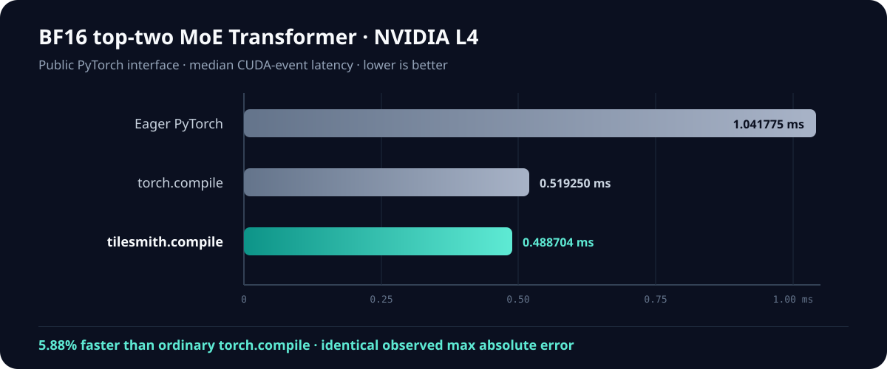

# Tilesmith



Tilesmith is a small optimization layer on top of PyTorch. You give it a normal
PyTorch callable and CUDA example inputs; PyTorch still runs Dynamo,
AOTAutograd, and TorchInductor first. Once Inductor has produced an eligible
Triton wrapper, a LangGraph Deep Agent can inspect, edit, run, profile, and
improve that generated code. Tilesmith installs a candidate only after the host
independently confirms output parity and a real speedup.

```python
import tilesmith

optimized_model = tilesmith.compile(model, example_inputs=(x,))
output = optimized_model(x)
```

The result remains a normal `torch.compile` callable. Tilesmith does not replace
PyTorch's graph capture, autograd integration, runtime wrappers, output
structure, or compiler caches.

## Installation

Use an environment that already has a matching CUDA build of PyTorch and
Triton, then install the agent dependencies:

```sh
python3 -m pip install -r requirements.txt
export OPENAI_API_KEY=...
export TILESMITH_MODEL=gpt-5.5
```

`OPENROUTER_API_KEY` is also supported. For an OpenAI
Responses-compatible gateway, set its base URL and key:

```sh
export OPENAI_BASE_URL=http://127.0.0.1:8317/v1
export OPENAI_API_KEY=your-proxy-key
```

## PyTorch interface

The public API is intentionally narrow:

```python
optimized_model = tilesmith.compile(
    model,
    example_inputs=(x,),
    loops=1,
    max_model_calls=None,
)
```

- `model` is any callable accepted by `torch.compile`.
- `example_inputs` is a tuple containing at least one CUDA tensor.
- `loops` is the number of independently accepted and confirmed improvements.
  It defaults to `1`; rejected candidates do not consume a loop.
- `max_model_calls` is an optional exact budget across the main agent and its
  subagents. It defaults to `None`, so there is no 70-step or model-call limit.
  Tool calls, shell commands, graph transitions, and benchmark repetitions do
  not count. Setting `max_model_calls=70` permits calls 1 through 70 and blocks
  call 71.

Compilation is lazy. The first real invocation lets PyTorch finish compiling
the graph, then Tilesmith extracts the raw generated wrapper and starts the
optimization track with real runtime inputs. Dynamic-shape, mixed-device,
multi-GPU, input-mutating, non-Triton, or already wrapped graphs stay on
ordinary Inductor. Tilesmith bypasses only AOTAutograd's higher-level artifact
cache because a warm hit skips the generated-source hook; Inductor's FX and
code caches remain enabled.

## What finishes an optimization

An agent final message ends one turn, not the optimization. After every turn,
the host evaluates the saved attempt itself:

1. Compare the candidate with the original Inductor callable on normal, zero,
   and high-magnitude inputs.
2. If it is correct, measure the paired lower-is-better CUDA-event latency.
3. Reject it when it does not beat the baseline by
   `TILESMITH_MIN_IMPROVEMENT` (default `0.02`).
4. Run a second fresh correctness and timing evaluation.
5. Complete one loop only when that confirmation also clears the required
   speedup.

Incorrect, duplicate, slower, or insufficiently faster candidates are reported
back to the agent, which receives a new attempt file and continues the same
loop. With the default unlimited model budget, the graph has no successful exit
without confirmed parity and speedup for every requested loop. An explicit
`max_model_calls=n` is the user-selected escape hatch: after call `n`, the host
still evaluates the current file and accepts it if it passes; otherwise the
optimization raises and the PyTorch wrapper warns and retains ordinary
Inductor. Infrastructure and model-provider failures also preserve the
Inductor fallback.

## Agent workspace

Each uncached graph gets a permissive Deep Agents graph with planning, file
editing, local bash, context management, a general-purpose subagent, and hosted
web search. It works in five rolling files:

```text
~/.cache/tilesmith/tracks/<graph-key>/attempts/
  attempt_00.py
  attempt_01.py
  attempt_02.py
  attempt_03.py
  attempt_04.py
```

Every agent turn starts in a new file copied from the most recently evaluated
candidate. Once all five names are occupied, Tilesmith discards the oldest
contents and shifts the other four down. Every Python attempt begins with the
captured PyTorch FX program as a non-executing comment block, followed by the
editable Inductor/Triton wrapper. Full host reports and agent traces are kept in
the adjacent `profiles/` directory.

Local bash receives a minimal environment without API credentials, but it is
still host shell access—not a security sandbox. Run Tilesmith only on code you
trust.

## GPU sandboxes

The agent and LangGraph loop stay in the calling Python process. If the target
GPU is remote, `gpu_shell(command, timeout_seconds)` gives the agent an open
shell in one persistent ComputeSDK sandbox. The agent can run arbitrary Python,
compile Triton or CUDA, install tools, inspect PTX or SASS, and invoke `ncu`,
`nsys`, or any other profiler available in the image. The current candidate is
mirrored into that workspace before each command and copied back afterward.
Host-owned correctness and timing harnesses remain separate from agent edits.

The default ComputeSDK provider is Modal:

```sh
export MODAL_TOKEN_ID=...
export MODAL_TOKEN_SECRET=...
```

```python
optimized_model = tilesmith.compile(
    model,
    example_inputs=(x,),
    sandbox="computesdk",
    chip="L4",
)
```

The local CUDA device must match `chip`, because the accepted callable runs in
the original Python process after remote validation. Remote optimization
currently supports `cuda:0` graphs. Tilesmith creates one sandbox for the full
graph track, keeps it warm through exploration and fresh confirmation, and then
awaits its destruction before closing the ComputeSDK client and event loop.
That teardown runs on both success and exception paths; the verified run below
left no active TileSmith Modal container.

`TILESMITH_SANDBOX_TIMEOUT` controls the maximum sandbox lifetime. Tilesmith
waits for real command readiness, verifies Python, `uv`, and a C compiler, and
installs the host's exact PyTorch and Triton versions. `COMPUTESDK_TEMPLATE` can
select a custom image. Other ComputeSDK providers can be configured with
`COMPUTESDK_PROVIDER`, `COMPUTESDK_PROVIDER_PACKAGE`,
`COMPUTESDK_PROVIDER_FACTORY`, `COMPUTESDK_PROVIDER_VERSION`, and
`COMPUTESDK_PROVIDER_CONFIG`.

## Verified L4 result

The graph at the top comes from this complete paid test on August 2, 2026:

```sh
python3 benchmark.py run \
  --chip L4 \
  --loops 1 \
  --max-model-calls 20 \
  --model gpt-5.3-codex-spark
```

The controlled fixture is a `4096 × 4096` FP16 RMSNorm. Its extracted baseline
deliberately repeats the same correct Triton launch four times, giving the agent
an obvious optimization to discover. This demonstrates the complete mechanism;
it is not a claim that arbitrary models receive the same gain.

| Measurement | Median latency | Ratio to paired eager PyTorch |
| --- | ---: | ---: |
| Eager PyTorch reference | 2.173123 ms | 1.000000 |
| Four-launch generated baseline | 1.041521 ms | 0.479062 |
| First accepted candidate evaluation | 0.369695 ms | 0.166958 |
| Fresh confirmation | 0.371251 ms | 0.167725 |

The fresh confirmation improved the normalized generated-wrapper ratio by
**64.99%**. The test used an NVIDIA L4 (`sm_89`), CUDA 13.0, driver 580.95.05,
PyTorch 2.13.0+cu130, and Triton 3.7.1. Each host evaluation used 25 warmups,
seven alternating paired samples, and 100 CUDA-event iterations per sample.
All three correctness cases passed. The Deep Agent made exactly 20 model calls,
used `gpu_shell` five times, repaired a real Triton 3.7 launch-API incompatibility,
and then the host performed both the candidate evaluation and fresh
confirmation before installing the result.

Run the fixture yourself with any supported ComputeSDK GPU:

```sh
python3 benchmark.py run --chip L4 --loops 1
```

For a public-interface smoke test using a deterministic BF16 top-two MoE
Transformer, run:

```sh
python3 moe_benchmark.py --chip L4
```

The MoE harness compares eager PyTorch, ordinary `torch.compile`, and
`tilesmith.compile`, and requires output parity before reporting interleaved
CUDA-event latency samples. These benchmark commands and uncached
`sandbox="computesdk"` compiles are the only paths that provision paid GPU
resources; ordinary local tests do not.

## Cache behavior

Accepted source is cached under `~/.cache/tilesmith`. The key covers generated
source, the PyTorch/Triton/CUDA stack, NVIDIA device, graph identity, sandbox
provider and chip, model, loops, model-call budget, improvement threshold, and
the loaded skill contents. Repeating the exact compile loads the accepted source
instead of running the agent or provisioning another sandbox. A changed graph
gets its own track, while each retry within one track begins from the most recent
candidate.
