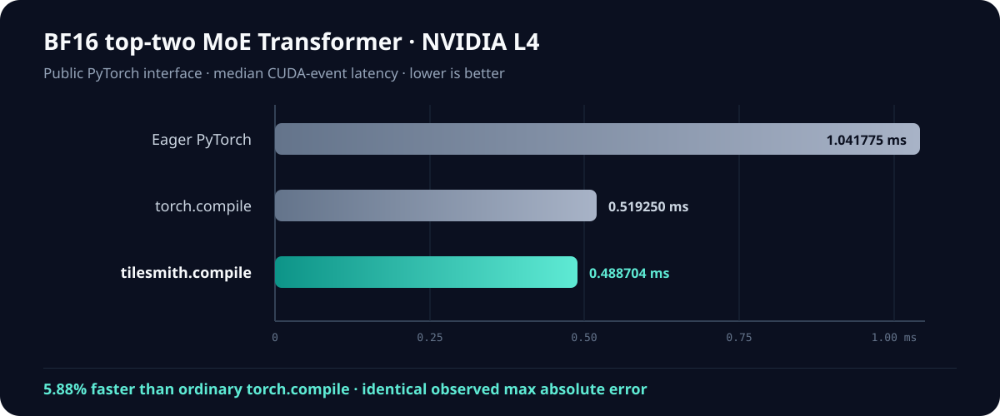

# Tilesmith



Tilesmith is a small optimization layer for PyTorch. PyTorch still performs
graph capture, AOTAutograd, and TorchInductor compilation. After Inductor emits
an eligible CUDA wrapper, Tilesmith gives that complete generated implementation
to a Deep Agent, measures its candidates against the original wrapper, and
installs only a numerically correct, independently confirmed speedup.

```python
import tilesmith

optimized_model = tilesmith.compile(model, example_inputs=(x,))
output = optimized_model(x)
```

`optimized_model` remains a normal `torch.compile` callable. Tilesmith does not
replace PyTorch or ask the model to rewrite the user's module.

## Install

Start with an environment that already has a matching CUDA build of PyTorch and
Triton, then install Tilesmith and its agent runtime:

```sh
python3 -m pip install tilesmith-ai
export OPENAI_API_KEY=...
export TILESMITH_MODEL=gpt-5.5
```

`OPENROUTER_API_KEY` is supported as an alternative. An OpenAI-compatible
gateway can be selected with `OPENAI_BASE_URL`; Tilesmith waits until the
requested model appears in `/v1/models` before starting an optimization.

## Compile from PyTorch

```python
optimized_model = tilesmith.compile(
    model,
    example_inputs=(x,),
    agency="medium",
    loops=1,
    max_model_calls=None,
)
```

`example_inputs` must be a tuple with at least one CUDA tensor. Compilation is
lazy: PyTorch finishes compiling first, and the first real invocation supplies
the concrete tensors used for Tilesmith's correctness and timing checks.

`agency` controls how broadly the agent may alter generated code. `"low"`
preserves the existing wrapper and kernel boundaries while allowing localized
tuning such as coalescing, tile sizes, launch parameters, and vectorization.
The default `"medium"` may restructure wrapper logic, intermediate buffers,
and kernel fusion or decomposition while preserving the high-level algorithm.
`"high"` may also redesign the algorithm and generated implementation. All
three levels preserve the generated callable ABI and pass the same host-owned
correctness, timing, and fresh-confirmation gates.

`loops` counts accepted optimization cycles, not agent turns or timing
repetitions. It defaults to `1`. A slower, incorrect, duplicate, or marginal
candidate is rejected and the same loop continues.

`max_model_calls` is an optional exact budget shared by the main agent and its
subagents. It defaults to `None`; there is no default 70-step limit. Shell,
tool, benchmark, and graph-transition calls do not consume this budget. For
example, `max_model_calls=70` permits exactly 70 model calls and blocks the
71st. If an explicit budget expires without a validated win, Tilesmith keeps
ordinary Inductor rather than installing an unconfirmed candidate.

Dynamic-shape, mixed-device, multi-GPU, input-mutating, and already wrapped
graphs currently stay on ordinary Inductor. A raw single-GPU CUDA wrapper stays
eligible whether it embeds Triton or generated CUDA templates, calls external
libraries, or combines them. Inductor's FX and generated-code caches remain
enabled.

## What the agent does

Each uncached graph gets a permissive LangGraph Deep Agents workflow. The agent
can plan, edit files, run bash, delegate a focused subtask, and use normal web
search. Its system context includes the target GPU, the generated wrapper ABI,
the host's validation contract, and the installed Triton, CUDA, and kernel
reference skills.

The local bash tool is intentionally unrestricted and runs with the calling
user's filesystem permissions. Tilesmith withholds the parent environment from
that shell, but it is not an OS sandbox; use the agent workflow only with a
trusted model and workspace. ComputeSDK isolates the optional GPU shell in the
provider sandbox, not the local Deep Agent process.

Each `tilesmith.compile()` call receives a unique run ID. When an eligible graph
is first invoked, it keeps five rolling source files within that run:

```text
~/.cache/tilesmith/runs/<run-id>/<cache-key>/attempts/
  attempt_00.py
  attempt_01.py
  attempt_02.py
  attempt_03.py
  attempt_04.py
```

`<cache-key>` is the 64-character SHA-256 identity of one generated graph and
its optimization environment. A single compile run may contain several such
graphs, such as forward, backward, or graph-break regions.

Every attempt starts with the captured PyTorch FX program as comments, followed
by one canonical Inductor-generated Python wrapper for that graph. The wrapper
contains its `call(args)` entry point, allocations, streams, launches, embedded
Triton or generated-template source when Inductor emits it, and external-library
call sites. Library implementations, weights, PTX, cubins, and shared objects
remain runtime dependencies or cache artifacts rather than being copied into
the attempt. Forward, backward, graph-break, and shape-specialized graphs each
receive their own track instead of being merged into one model-sized file.

A new turn copies the most recently evaluated source. After `attempt_04.py`,
the oldest contents are discarded and the other attempts shift down. Complete
host reports and per-turn structured agent traces are retained beside the
attempts under `profiles/`. An exact artifact-cache hit does not rerun the
agent; its fresh run track contains `cache.json`, which identifies the reused
artifact.

An agent final answer ends only that agent turn. The outer LangGraph does not
finish a requested loop until the host:

1. compares the candidate with the original Inductor wrapper on normal, zero,
   and high-magnitude inputs, including output strides;
2. measures alternating paired CUDA-event samples;
3. observes at least `TILESMITH_MIN_IMPROVEMENT`, which defaults to `0.02`;
4. repeats correctness and timing in a fresh confirmation; and
5. sees the confirmation clear the same speedup threshold.

With the default unlimited model-call budget, the graph keeps returning failed
measurements to the agent until every requested loop has confirmed parity and a
speedup. Provider or infrastructure errors warn and preserve the original
Inductor callable.

## GPU sandboxes

Tilesmith can give the agent an unrestricted shell on the target GPU through
the bundled ComputeSDK sandbox layer:

```sh
export MODAL_TOKEN_ID=...
export MODAL_TOKEN_SECRET=...
```

```python
optimized_model = tilesmith.compile(
    model,
    example_inputs=(x,),
    sandbox="computesdk",
    chip="L4",
)
```

The agent can use `gpu_shell` for arbitrary Python, Triton, CUDA, package
installation, PTX or SASS inspection, `ncu`, `nsys`, and any other available
tool. One sandbox stays warm for the complete graph track, including rejected
attempts and fresh confirmation. The accepted callable still executes in the
calling process, so its local CUDA device must match `chip`; remote evaluation
currently supports `cuda:0` graphs.

Sandbox ownership is deterministic. Tilesmith awaits sandbox destruction
before closing the ComputeSDK client and its event loop, on both success and
exception paths. The end-to-end run below completed with no TileSmith Modal
container or ComputeSDK bridge process from this checkout left running.

A focused L4 smoke test also compiled `x @ y` into a 3,188-byte wrapper that
called `extern_kernels.mm` and contained no Triton kernel. Reloading that exact
source through Inductor's `PyCodeCache` preserved numerical parity, and the
sandbox was destroyed after the check.

Modal is the default provider. Other ComputeSDK providers can be selected with
`COMPUTESDK_PROVIDER`, `COMPUTESDK_PROVIDER_PACKAGE`,
`COMPUTESDK_PROVIDER_FACTORY`, `COMPUTESDK_PROVIDER_VERSION`, and
`COMPUTESDK_PROVIDER_CONFIG`. `COMPUTESDK_TEMPLATE` selects an image and
`TILESMITH_SANDBOX_TIMEOUT` bounds the sandbox lifetime.

## Verified end-to-end result

On August 3, 2026, the public interface was tested with the deterministic BF16
top-two MoE Transformer in `moe_benchmark.py`:

```sh
python3 moe_benchmark.py --chip L4 --model openai/gpt-5.3-codex
```

The workload used an `8 × 128` token input, width 256, eight attention heads,
four experts with hidden width 512, and a 2,048-token output vocabulary. The
test ran on an NVIDIA L4 with CUDA 13.0, driver 580.95.05, PyTorch
2.13.0+cu130, and Triton 3.7.1.

| Execution path | Median latency | Speedup over eager | Speedup over `torch.compile` |
| --- | ---: | ---: | ---: |
| Eager PyTorch | 1.041775 ms | 1.000× | — |
| `torch.compile` | 0.519250 ms | 2.006× | 1.000× |
| `tilesmith.compile` | **0.488704 ms** | **2.132×** | **1.059×** |

Tilesmith was **5.88% faster than ordinary `torch.compile`** end to end. Each
number is the median of seven alternating samples with 25 warmups and 100
CUDA-event-timed invocations per sample. The observed sample ranges were
1.037865–1.049756 ms for eager PyTorch, 0.509983–0.524361 ms for
`torch.compile`, and 0.486390–0.492706 ms for Tilesmith.

Both compiled paths had the same maximum absolute error versus eager PyTorch:
`0.13671875`. The generated-wrapper gate also passed all three correctness
inputs and independently confirmed a 4.19% improvement, from a normalized
score of `1.0` to `0.958067`. Before accepting that source, the graph rejected
three candidates scoring `0.997462`, `0.985625`, and `0.980071`; the last was
still below the required 2% margin. The successful uncapped track used 91 model
calls, which also exercises the absence of a hidden 70-call limit.

## Cache and validation

Accepted source is stored once under
`~/.cache/tilesmith/artifacts/<cache-key>.py`, with its manifest and lock under
`manifests/` and `locks/`. Its key includes the generated source, Inductor graph
identity, PyTorch/Triton/CUDA stack, NVIDIA device, model, agency, loop count,
optional model-call budget, required improvement, sandbox placement, and loaded
skill contents. Each eligible graph gets its own evidence directory under
`runs/<run-id>/<cache-key>/`, even when it reuses the shared accepted
source. Repeating the same compile therefore skips the agent and sandbox but
still leaves a separate cache-hit record; a changed graph starts a new agent
track in its own run.

Local tests do not provision paid GPUs:

```sh
python3 -m unittest discover -s tests -v
```

`moe_benchmark.py` is the public end-to-end GPU test. `benchmark.py run` is the
smaller controlled agent/sandbox fixture. Both exit nonzero unless correctness
and the required speedup pass.
